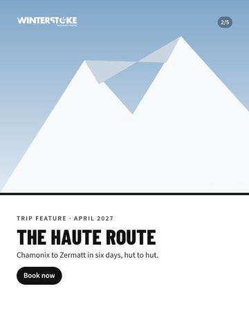

# Brand Studio

Turns marketing-calendar items and your photos into consistent, on-brand Meta content: **feed posts and carousels, stories, and paid ads**, for Altus, Corvus and Winterstoke. Nothing goes out until it is approved.

<p>




</p>

*(Placeholder photo. All brands use a black-and-white palette and their own logo from `assets/logos`.)*

## How it works

```
Calendar item ──► drop photos ──► Claude plans ──► templates render ──► review ──► Meta
 (date, brand,      (+ credit)     • checks each photo     JPEGs at 4:5      edit text,    • IG + FB post / carousel
  pillar, brief)                     (subject, focal        and 9:16          approve       • IG + FB story
                                      point, rule breaks)                                   • paused ad in your ad set
                                   • picks layout per slide
                                   • writes overlay text,
                                     caption, ad copy
```

**Consistency comes from the templates, not from AI image generation.** Claude only chooses *which photo, which layout and which words*. Fonts, colours, logo placement, gradients, safe zones and sizes are fixed code (`src/lib/render/templates.tsx`), so every post from a brand looks like it belongs.

| Calendar item | What gets made |
|---|---|
| `post` (single) | 4:5 feed image + caption + hashtags, and a matching 9:16 story frame |
| `post` (carousel) | 3–10 slide 4:5 carousel (cover → info slides → end card) + story frame |
| `story` | 1–3 story frames (9:16, text kept clear of Meta's top/bottom UI) |
| `ad`, or any item with an ad set id | One ad design rendered at 4:5 (feeds) **and** 9:16 (Stories/Reels), plus primary text, headline, description and button, created **paused** in your ad set |
| `event` | Feed post + story |
| `reel`, `email`, `film` | Stay on the calendar as reminders (video isn't generated) |

### Guardrails
- **Approval is enforced on the server.** Only `approved` creatives can publish or create ads, including from the scheduler. Editing an approved creative sends it back to draft.
- Ads are always created **PAUSED**. Nothing spends money until you switch the ad on in Ads Manager.
- Claude only uses prices, dates and offers written in the item's brief. Anything missing goes into **"Check before approving"** notes instead of being invented.
- Brand rules live in each brand kit and go into every prompt. Defaults include "Black Friday offers go to email and the MTN Club only, never the feed" (Altus) and "riders must be on splitboards, flag unclear photos" (Corvus).
- Photographer credits you enter at upload are put on the image and added to the caption.

## Layout

```
src/lib/brand.ts           brand kit type + defaults for altus / corvus / winterstoke
src/lib/formats.ts         Meta sizes, story safe zones, copy limits, item → placements
src/lib/copy.ts            Claude call (vision + structured output) → creative plan
assets/logos/              white + black logo per brand
src/lib/render/            Satori templates → PNG → JPEG; focal-point photo cropping
src/lib/generate.ts        item + photos → plan → rendered creatives in storage
src/lib/meta/              Graph API: IG/FB publishing, paused ads with per-placement images
src/lib/publishing.ts      approval-gated publish
src/lib/jobs.ts            background jobs (generate, re-render, publish, touch-up, learn) + scheduler
src/lib/learning.ts        feedback capture, history for prompts, rule suggestions
src/lib/touchup.ts         OpenAI photo extension for stories
netlify/functions/         background worker, 15-minute publisher, Monday inspiration sync
src/lib/inspiration.ts     screenshot analysis, Instagram watch list, weekly report
src/app/                   calendar, item workspace, brand kits, API routes
supabase/migrations/       schema (RLS on, server-only access)
supabase/seed.sql          brands + the 92 items / 10 week themes from the calendar artifact
data/artifact-calendar.ts  the artifact's calendar data, copied for the import
```

## Setup

### 1. Supabase
1. Create a project (e.g. "brand-studio").
2. Run `supabase/migrations/0001_init.sql`, then `supabase/seed.sql` (SQL editor or `supabase db push`).
3. Auth → URL configuration: add `https://<your-domain>/auth/callback` as a redirect URL.

### 2. Meta
1. In **Business Settings**, create a **System User** (Admin) and assign it the three Facebook Pages, the three Instagram accounts and the ad account(s).
2. Generate a long-lived token for that System User from your Meta app with: `pages_manage_posts`, `pages_read_engagement`, `instagram_basic`, `instagram_content_publish`, `ads_management`, `business_management`.
3. Put the token in `META_SYSTEM_USER_TOKEN`. On the **Brands** page, fill in each brand's Page id, Instagram user id, ad account id and (optionally) a default ad set id.
4. Ads go into an **existing** ad set (where you set budget, schedule and audience in Ads Manager). Set it per item, or use the brand default.

### 3. Deploy (Netlify)
1. New site from this GitHub repo. `netlify.toml` sets the build, and Netlify's Next.js support is detected automatically.
2. Site settings → Environment variables: add everything from `.env.example`, including `JOB_RUNNER=netlify`, `SITE_URL`, and long random values for `JOB_SECRET`.
3. In Supabase Auth → URL configuration, set the Site URL and add `https://<site>/auth/callback`.

**Why background jobs:** making a post (Claude + rendering) or publishing a carousel can take up to a minute, which is longer than a normal web request should wait. The page queues a job and checks on it every couple of seconds, and the work runs in `netlify/functions/worker-background.mts`. `netlify/functions/publish-due.mts` runs every 15 minutes and queues approved posts whose time has come.

Local development: `cp .env.example .env.local`, remove `JOB_RUNNER`, then `npm install && npm run dev`. Jobs run in-process.

### 4. Brand kits
All three brands are black and white. Logos come from `assets/logos/<brand>-white.png` (used on photos and dark backgrounds) and `-black.png`; these were made from the PNGs in Drive. Uploading a logo on **Brands** overrides the file. The Altus and Corvus PNGs are small (170 px and 160 px wide), so a larger export or SVG-to-PNG would make them sharper. Fonts come from `@fontsource` packages so rendering never fetches anything over the network. To use a different typeface, `npm i @fontsource/<family>` and add it to `src/lib/render/fonts.ts`.

## Day to day
1. Open the calendar → click an item (or **New item**).
2. Fill in the **brief**: the message, dates, price, offer and link. Claude only states facts written here.
3. Drop photos in (JPEG/PNG/WebP), with a credit if needed. Optional: give Claude a direction ("5-slide carousel, summit shot on the cover").
4. **Generate** → review the slides, caption and ad copy. Read any **Check before approving** notes and photo warnings.
5. Tweak the on-image text, layout or photo per slide (re-renders in a few seconds), or edit the caption.
6. **Approve** each creative. Organic posts publish automatically on the date; use **Publish now** to post right away, and **Create paused ad** for ads.

## Learning from your reviews
Claude isn't retrained. Instead, every review is recorded and fed back into the next request for that brand:

- **Approved as-is**: becomes a style example (same pillar first).
- **Approved after edits**: Claude's version is kept next to yours, and the before → after changes ("headline: X → Y") are shown to Claude next time.
- **Rejected**: you give a one-line reason, and Claude is told to avoid it.
- **Suggested rules**: on the Brands page, "Suggest rules" reads the recent reviews and proposes house-style rules (e.g. "Keep on-image headlines to 5 words"). You edit, accept or dismiss each one. Accepted rules join the brand's hard rules. Nothing is added without you.

## Inspiration board
**Inspiration** (top nav) collects design ideas in two ways:

- **Screenshots:** drop, paste or choose screenshots of posts or ads you like, and say what you like about them. Claude pulls out the transferable traits (layout, type, copy, photo), suggests rules, and names the closest existing template. If the look needs a layout you don't have, it drafts a **template request**.
- **Watch list:** add Instagram **business or creator** accounts per business, such as competitors and brands you admire. Every Monday (or with **Sync now**), the official Business Discovery API pulls their recent posts. Each post is scored against that account's own normal engagement; the standouts are saved and analysed, and a **"What's working"** report is written. Rule ideas from the report go to the Brands page as suggestions. Personal accounts can't be read, and reach or saves aren't available for other accounts.

What it feeds back:
- Rules you add from a card go straight into that brand's rules (or every brand's, for "All businesses").
- Copy and layout traits from inspiration you've **kept** are included in future generation requests as "styles the reviewer likes".
- New visual layouts are never invented by the AI on the fly. They become template requests that get built properly in `src/lib/render/templates.tsx`, so every post stays consistent.

Claude is instructed to borrow traits, never to copy another brand's photos, wording, logo or look. Images are stored privately for reference only.

## Photo touch-ups (OpenAI)
On a wide photo, **Extend for stories (AI)** creates a 9:16 version by generating more sky and snow above and below it. The real photo is pasted back over the middle at full quality, so only the added bands are AI-made. That version is used only for story-shaped images, it's marked "AI-extended" in the workspace, and **Undo** returns to normal cropping. The prompt forbids adding people, skiers, text or objects. Look at it before approving. Meta may ask for an "AI info" label on ads that use edited images.

## Calendar views
The calendar has **Month**, **Week** and **Day** views and a business switcher (**All / Altus / Corvus / Winterstoke**). Each view shows a per-business tally for the period:

- **Posted**: live on Meta (filled dot)
- **Scheduled**: approved, publishes automatically (green)
- **In review**: drafts waiting for approval (ring)
- **Planned**: on the calendar, nothing made yet (dashed)

Month shows every item in a compact list (on a phone, only days with items). Week shows the creative thumbnail, time and status. Day shows every slide, story frame and caption, ready to review. Click a date to jump to that day.

## Useful commands
```bash
npm run preview:mock                          # UI preview with the imported calendar and fake statuses (no Supabase); set .env.local to the mock values in scripts/dev/mock-supabase.ts
npm run render:samples -- path/to/photo.jpg   # every layout × brand × size into ./samples (no keys needed)
npm run import:calendar                       # rebuild supabase/seed.sql from data/artifact-calendar.ts
npm run typecheck
```

## Not built yet
- Video (Reels): items stay on the calendar, but there's no generation.
- Creating campaigns or ad sets from the app (ads go into an ad set you made in Ads Manager).
- Performance reporting back from Meta.
