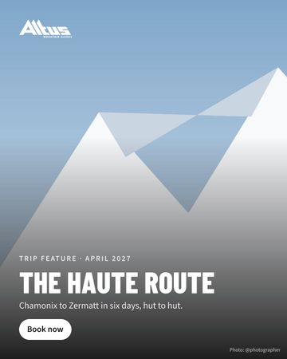
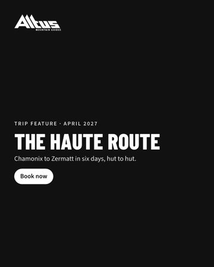
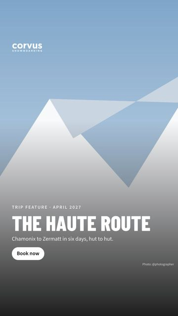

# Brand Studio

Turns marketing-calendar items and your photos into consistent, on-brand Meta content: **feed posts and carousels, stories, and paid ads**, for Altus, Corvus and Winterstoke. Nothing goes out until it is approved.

<p>




</p>

*(Rendered with a placeholder photo and the placeholder brand colours. Swap in the real logos and colours on the Brands page.)*

## How it works

```
Calendar item ──► drop photos ──► Claude plans ──► templates render ──► review ──► Meta
 (date, brand,      (+ credit)     • checks each photo     JPEGs at 4:5      edit text,    • IG + FB post / carousel
  pillar, brief)                     (subject, focal        and 9:16          approve       • IG + FB story
                                      point, rule breaks)                                   • paused ad in your ad set
                                   • picks layout per slide
                                   • writes overlay text,
                                     caption, ad copy
```

**Consistency comes from the templates, not from AI image generation.** Claude only chooses *which photo, which layout and which words*. Fonts, colours, logo placement, gradients, safe zones and sizes are fixed code (`src/lib/render/templates.tsx`), so every post from a brand looks like it belongs.

| Calendar item | What gets made |
|---|---|
| `post` (single) | 4:5 feed image + caption + hashtags, and a matching 9:16 story frame |
| `post` (carousel) | 3–10 slide 4:5 carousel (cover → info slides → end card) + story frame |
| `story` | 1–3 story frames (9:16, text kept clear of Meta's top/bottom UI) |
| `ad`, or any item with an ad set id | One ad design rendered at 4:5 (feeds) **and** 9:16 (Stories/Reels), plus primary text, headline, description and button, created **paused** in your ad set |
| `event` | Feed post + story |
| `reel`, `email`, `film` | Stay on the calendar as reminders (video isn't generated) |

### Guardrails
- **Approval is enforced on the server.** Only `approved` creatives can publish or create ads, including from the scheduler. Editing an approved creative sends it back to draft.
- Ads are always created **PAUSED**. Nothing spends money until you switch the ad on in Ads Manager.
- Claude only uses prices, dates and offers written in the item's brief. Anything missing goes into **"Check before approving"** notes instead of being invented.
- Brand rules live in each brand kit and go into every prompt. Defaults include "Black Friday offers go to email and the MTN Club only, never the feed" (Altus) and "riders must be on splitboards, flag unclear photos" (Corvus).
- Photographer credits you enter at upload are put on the image and added to the caption.

## Layout

```
src/lib/brand.ts           brand kit type + defaults for altus / corvus / winterstoke
src/lib/formats.ts         Meta sizes, story safe zones, copy limits, item → placements
src/lib/copy.ts            Claude call (vision + structured output) → creative plan
src/lib/render/            Satori templates → PNG → JPEG; focal-point photo cropping
src/lib/generate.ts        item + photos → plan → rendered creatives in storage
src/lib/meta/              Graph API: IG/FB publishing, paused ads with per-placement images
src/lib/publishing.ts      approval-gated publish + scheduled publishing
src/app/                   calendar, item workspace, brand kits, API routes
supabase/migrations/       schema (RLS on, server-only access)
supabase/seed.sql          brands + the 92 items / 10 week themes from the calendar artifact
data/artifact-calendar.ts  the artifact's calendar data, copied for the import
```

## Setup

### 1. Supabase
1. Create a project (e.g. "brand-studio").
2. Run `supabase/migrations/0001_init.sql`, then `supabase/seed.sql` (SQL editor or `supabase db push`).
3. Auth → URL configuration: add `https://<your-domain>/auth/callback` as a redirect URL.

### 2. Meta
1. In **Business Settings**, create a **System User** (Admin) and assign it the three Facebook Pages, the three Instagram accounts and the ad account(s).
2. Generate a long-lived token for that System User from your Meta app with: `pages_manage_posts`, `pages_read_engagement`, `instagram_basic`, `instagram_content_publish`, `ads_management`, `business_management`.
3. Put the token in `META_SYSTEM_USER_TOKEN`. On the **Brands** page, fill in each brand's Page id, Instagram user id, ad account id and (optionally) a default ad set id.
4. Ads go into an **existing** ad set (where you set budget, schedule and audience in Ads Manager). Set it per item, or use the brand default.

### 3. Environment and deploy
```bash
cp .env.example .env.local   # fill in
npm install
npm run dev                  # http://localhost:3000
```
Deploy to Vercel with the same env vars. `vercel.json` runs `/api/cron/publish` every 15 minutes to publish approved items at their time (the brand's default publish time on the item's date, or the item's own "publish at"). A 15-minute cron needs a paid Vercel plan; on Hobby, change it to daily or use "Publish now".

### 4. Brand kits
On **Brands**, set the exact colours and upload a white/light PNG logo for each brand. Fonts come from `@fontsource` packages so rendering never fetches anything over the network. To use a different typeface, `npm i @fontsource/<family>` and add it to `src/lib/render/fonts.ts`.

## Day to day
1. Open the calendar → click an item (or **New item**).
2. Fill in the **brief**: the message, dates, price, offer and link. Claude only states facts written here.
3. Drop photos in (JPEG/PNG/WebP), with a credit if needed. Optional: give Claude a direction ("5-slide carousel, summit shot on the cover").
4. **Generate** → review the slides, caption and ad copy. Read any **Check before approving** notes and photo warnings.
5. Tweak the on-image text, layout or photo per slide (re-renders in a few seconds), or edit the caption.
6. **Approve** each creative. Organic posts publish automatically on the date; use **Publish now** to post right away, and **Create paused ad** for ads.

## Useful commands
```bash
npm run render:samples -- path/to/photo.jpg   # every layout × brand × size into ./samples (no keys needed)
npm run import:calendar                       # rebuild supabase/seed.sql from data/artifact-calendar.ts
npm run typecheck
```

## Not built yet
- Video (Reels): items stay on the calendar, but there's no generation.
- Creating campaigns or ad sets from the app (ads go into an ad set you made in Ads Manager).
- Performance reporting back from Meta.
